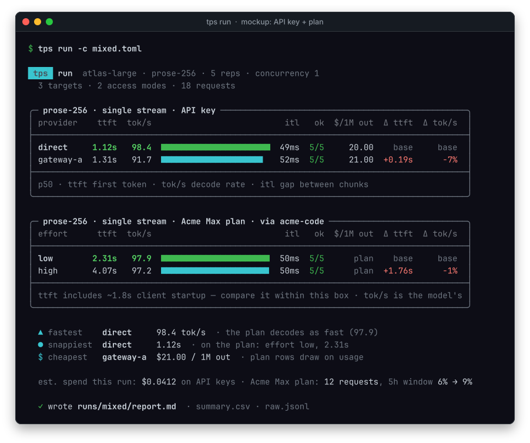
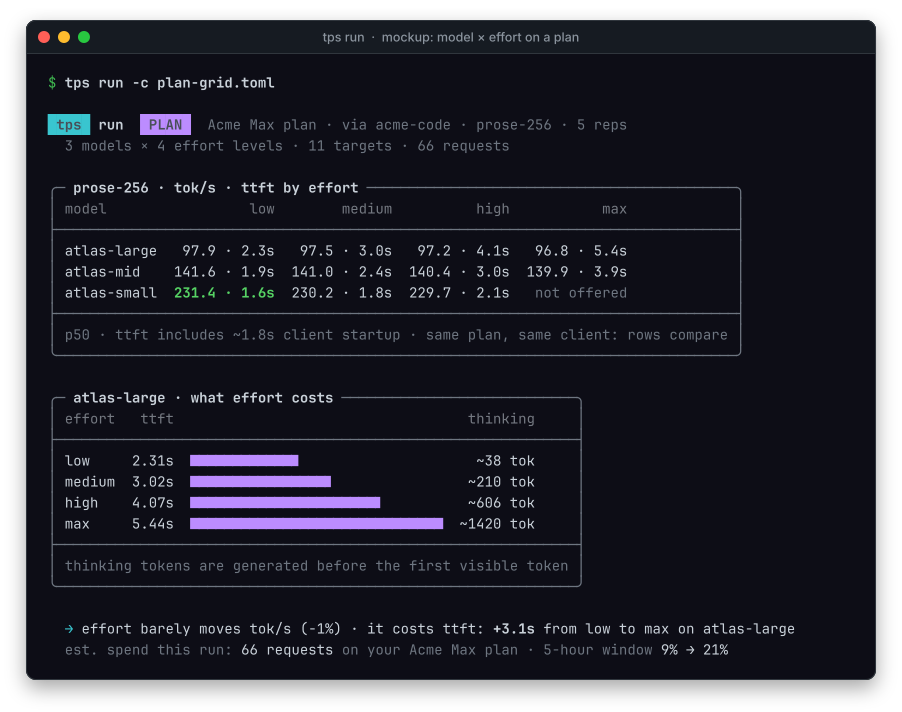
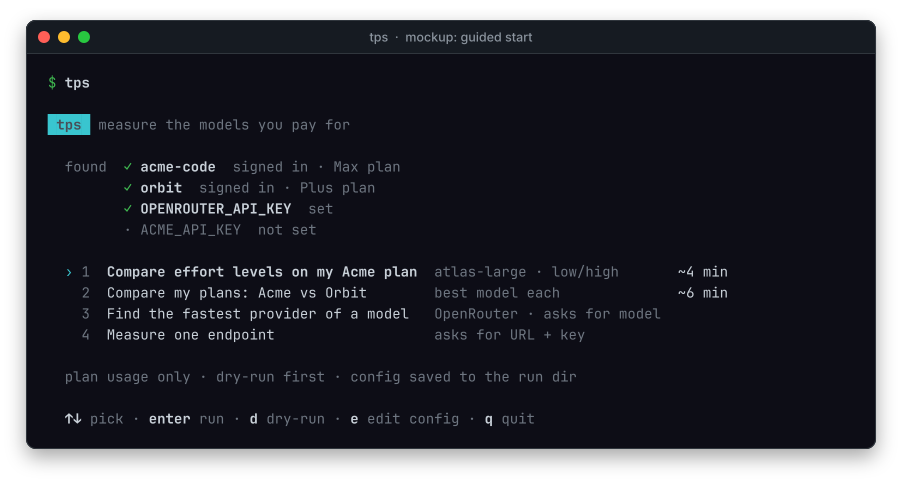

# Design: access modes, model × effort grids, and a guided TUI

Status: **in progress** (2026-11-02). Step 1 (`api = "claude-code"`) is in PR #6; step 2 (effort + grids) on `feat/effort-grids`.

## Problem

`tps` answers one question well: *which provider serves model X fastest?* It reaches
every model the same way, over HTTP with an API key, and the only thing a run varies
is the target.

People actually pay for models in three different ways, and want to compare along
more axes than provider:

| Access mode | Typical question | Today |
|---|---|---|
| **API key, one endpoint** | "How fast is Opus 5.5 on my Anthropic key?" | ✅ `--base-url`, `--api anthropic` |
| **Gateway → many providers** | "Which provider of DeepSeek V4.1 is fastest per dollar?" | ✅ `discover` (OpenRouter) |
| **Subscription plan, via the vendor's CLI** | "How fast are the models in the plan I already pay for — and is high effort worth it?" | ❌ |

A subscription plan can't be benchmarked over raw HTTP: plan credentials are only
honored by the vendor's own client (Anthropic answers a bare OAuth request with
`429 rate_limit_error`, measured 2026-11-01). The supported route is to run that client
headless — which Anthropic documents as drawing from plan limits (`claude -p`, Agent
SDK; support article *Use the Claude Agent SDK with your Claude plan*, updated
2026-10-07). `tps` does that, and never extracts, stores or replays plan tokens, and
never sends requests that impersonate a vendor client.

## Concepts

A **target** stays the unit everything is keyed on. It gains two fields:

- `access` — how requests are sent: `http` (today's behaviour, the default) or `cli`
  (spawn a vendor client headless).
- `effort` — the reasoning/effort level, passed in whatever form the access mode
  takes (`--effort high` for `claude`, `reasoning_effort` / `thinking` budgets over
  HTTP). `null` = the provider default, reported as such.

`api` keeps naming the wire format. For `access = "cli"` it names the client:

| `api` (cli) | Plan | Headless entry | Status |
|---|---|---|---|
| `claude-code` | Claude Pro/Max/Ultra/Team | `claude -p --output-format stream-json --include-partial-messages` | step 1 |
| `codex` | ChatGPT plans | `codex exec --json` | step 3 |
| `grok` | SuperGrok / X | `grok -p` (stream format TBD) | step 3 |
| `opencode` | whatever it's signed into | `opencode run` | step 3 |
| `muse` | Muse Code | `muse exec` | step 3 |
| `antigravity`, `command-code`, NanoGPT | — | research | later |

NanoGPT is API-key based and likely fits `access = "http"` with an OpenAI-compatible
`base_url`, no new backend. Each CLI backend is admitted only after checking the
vendor's *current* terms for headless use of that plan.

### Grids

A run can expand a grid instead of listing every target by hand:

```toml
[[grids]]
name   = "claude-plan"
access = "cli"
api    = "claude-code"
models = ["claude-opus-5-5", "claude-sonnet-5-5", "claude-haiku-5-5"]
effort = ["low", "high"]
# → 6 targets: claude-plan/opus-5-5@low, …/haiku-5-5@high
```

Expanded targets interleave like any others (invariant 2). Reports gain `access`,
`model` and `effort` columns and group by whichever axis varies.

## Measuring through a CLI honestly

A CLI adds work that isn't the model. The backend separates it rather than hiding it:

- **Context is stripped.** No tools, no MCP servers, no user/project settings, a
  one-line system prompt — `claude` otherwise sends ~245k tokens of skills and tool
  definitions per call (measured). The effective input size is reported.
- **TTFT has two parts.** `spawn_to_stream_s` (process start → first stream event,
  i.e. CLI startup + request) and `ttft_s` (process start → first answer token). Rows
  are tagged `access: cli` and the report notes that TTFT includes client startup, so
  they're never ranked against HTTP TTFT without that caveat.
- **tok/s is the model's.** Answer tokens come from the client's `usage`
  (`output_tokens − thinking_tokens`), divided by first→last answer token, exactly
  like HTTP targets. If a client reports no usage, chars/4 is used and flagged
  (invariant 4).
- **Output caps may be soft.** `CLAUDE_CODE_MAX_OUTPUT_TOKENS` was exceeded in testing
  (2,908 tokens against a 2,048 cap); rows record the real count and `notes` say when
  a cap wasn't honored.
- **Cost** is `plan` (draws on subscription limits), not dollars; `cost_unpriced`
  lists these targets. Dry-run still reports request count and minutes.
- **No retries, failures are data** (invariant 1). A non-zero exit, `is_error`, or a
  rate-limit event becomes an error class (`cli_exit_N`, `cli_error`, `rate_limited`).
- **Tests stay offline** (invariant 6): a fake `claude` script replays recorded
  stream-json.

## Presentation: extend the existing CLI, don't replace it

`tps run` already has a visual language (README screenshots): a badge header,
one titled box per comparison, inline bars, best-per-column in bold green,
green/red deltas, dim footers, `▲ ● $` callouts. New dimensions fit into it:

- **Show only what varies.** Shared settings move to the header line; model,
  effort or access mode become columns only when they differ.
- **One box per access mode**, its caveat in the title/footer (CLI TTFT includes
  startup). Best-per-column and deltas are computed within a box, so unlike
  measurements are never ranked against each other.
- **A `PLAN` badge** beside `MOCK DATA`; `plan` in the `$/1M out` column; the
  spend line adds plan requests and the 5-hour-window change (from the CLI's
  `rate_limit_event`).
- **Model × effort** renders as a matrix box plus a "what effort costs" bar box,
  with a generated one-line takeaway only when it holds for every row.

Mockups — composed with tps's own `ui.py` components and drawn by the README
renderer (`scripts/render_mockups.py`, fictional data):





## Guided start (bare `tps` on a TTY)

`tps` with no arguments, on a TTY:

1. **Detect** what's available: signed-in vendor CLIs, `ANTHROPIC_API_KEY`,
   `OPENROUTER_API_KEY`, other `*_API_KEY`s, an existing `targets.toml`.
2. **Offer presets**: *"Benchmark the models in my Claude plan"*, *"Compare effort
   levels"*, *"Find the fastest provider of a model"* (OpenRouter), *"Measure one
   endpoint"*.
3. **Show the dry-run plan** — requests, minutes, worst-case $ or "plan usage" — and
   ask before sending anything.
4. **Live progress** (current target, ok/failed counts), then the report; the
   generated config is saved to the run dir so the run is reproducible
   non-interactively.

`--json` and non-TTY behaviour are unchanged; the TUI is a front end over the same
engine. A local web report view can follow once the TUI settles.

## Build order

0. **Housekeeping** — repo `.venv` is broken (no `tps`, no `httpx`, no pip).
1. **`api = "claude-code"` CLI backend** — subprocess runner producing ordinary
   samples, `effort`, doctor check for the binary/login, selftest with a fake client,
   docs.
2. **`effort` for HTTP targets** + **grids** + report columns.
3. **More CLI backends** (`codex`, `grok`, `opencode`, `muse`), one at a time, each
   with recorded fixtures and a terms check.
4. **Presentation** (boxes per access mode, `PLAN` badge, plan spend, effort matrix),
   then the **guided start** — built on the existing `UI`/`Progress`, no new dependency.

## Open questions

- Concurrency for CLI targets: N parallel processes measures the plan's concurrency
  limit, not a server's. Keep it allowed but label it.
- Should a grid row with `effort = null` be included automatically as the "default"
  baseline?
- Fingerprinting over CLI targets: no logprobs; probably excluded.
